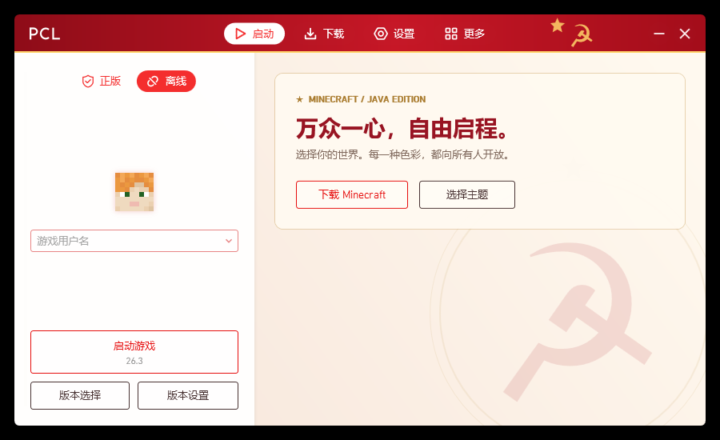
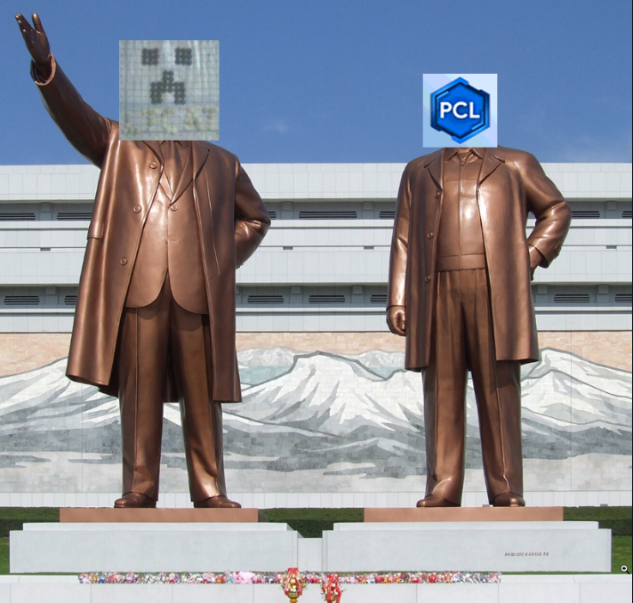

# PCL Communist

<p align="center"></p>

**让所有颜色属于所有人。**

基于 Plain Craft Launcher 的第三方独立修改版。原作者为龙腾猫跃及 PCL 贡献者；本项目由社区独立维护。

[下载单文件 EXE](https://github.com/Angelhellwolf/PCL-Communist/releases/latest) · [下载跨平台预览](https://github.com/Angelhellwolf/PCL-Communist/releases/tag/v0.1.0-preview.1) · [共产共享协议](COMMUNIST-AGREEMENT.txt) · [查看源代码](https://github.com/Angelhellwolf/PCL-Communist) · [反馈问题](https://github.com/Angelhellwolf/PCL-Communist/issues)



## 使用

在 Releases 下载启动器 EXE，直接运行。运行环境为 Windows 与 .NET Framework 4.8，无需旁置 DLL、配置文件或安装 .NET SDK。程序运行后会按需创建设置、日志和游戏文件。

## 平台支持

| 平台 | 当前状态 | 游戏启动与验证 |
| --- | --- | --- |
| Windows | 已发布单文件 EXE | 当前支持的平台 |
| macOS（Intel / Apple Silicon） | 新增独立跨平台预览工程与 `.app` 打包 | 已实现分架构 Java、原生库与启动参数；尚需 Mac 真机游戏验证 |
| Linux | 新增共用桌面预览工程 | 已实现原版启动路径；核心与界面检查在 Linux 执行 |
| Android | 新增原生预览工程，可构建 arm64 APK | 共用界面、登录与资源下载已移植；**游戏运行时尚未接入** |
| iOS / iPadOS | 新增 iPhone/iPad 原生入口与模拟器构建工作流 | 需要 Mac/Xcode 编译；**游戏运行时尚未接入** |

原 Windows 启动器使用 .NET Framework 4.8、WPF 和 Windows Forms；[WPF 仅支持 Windows](https://learn.microsoft.com/dotnet/desktop/wpf/overview/)。新移植工程位于 `CrossPlatform/`，使用 .NET 10 与 Avalonia，共用核心与界面，提供各系统原生入口。当前 Releases 中的 EXE 仍为 Windows 正式版；跨平台工程是功能尚未完整迁移的预览版，移动端当前不能启动游戏。构建方法、能力和验证边界见[跨平台预览说明](docs/cross-platform.md)。

## 功能

- 默认苏维埃红主题：红金配色、镰刀锤子背景，以及统一的程序、窗口和启动图标。
- 全部 17 个主题直接可选，包括隐藏、成就、自定义和动态主题；移除赞助遮罩及解锁条件。
- 开放 Minecraft 客户端下载，不设置中国大陆地区的下载限制；默认优先 BMCLAPI 镜像，保留官方回退和文件哈希校验。实际可达性取决于下载源与当地网络。
- 保留微软正版登录、账号刷新、正版购买验证、离线模式，以及游戏、Java、加载器、模组和整合包下载所需的元数据。
- 移除启动器远程更新、配置下发、遥测、联网主页、远程帮助、EasyTier、第三方登录和在线皮肤管理。
- 首次启动直接进入主页，移除“协议授权”弹窗和启动阻断。
- 关于页面可离线查看《共产共享协议》：免费共享、全部主题平等开放、修改源码公开；启动无需点击同意。

## 为什么我们把它叫作“共产主义”

在这个启动器里，我们把“真正的共产主义”落实为几件可以检查的事：所有用户获得相同的主题选择，下载入口不按地区划分身份，修改源码公开，改进可以由社区共同参与。红色属于每个人，金色也属于每个人；自愿赞助可以支持开发，不能成为颜色的户籍。

社会主义的优越性，在本项目的设计立场中体现为共同享有和公平可及：降低使用门槛，让每个人都能受益于共同维护的工具，把时间花在修复问题和改善体验上。我们的口号有一点戏谑，功能选择是认真的。

## 关于“资本主义”和“配色反革命”的讽刺

龙猫的开发劳动值得署名，龙猫制定的规则也应当接受批评。[上游分发指南](https://github.com/lZiMUl/PCL2/blob/6b9a50df911c9d68b69b24c979efba477fb14b67/LICENCE)要求 Windows 修改版避免与赞助解锁功能相似的表现，并以主要色相必须为蓝色为例。在我们看来，把颜色与赞助特权绑定、再限制其他修改版提供相同选择，体现的是资本主义的排他和差别待遇逻辑。

我们把这套管理方式戏称为“朝鲜式的 RGB 王国”：连换个颜色，都仿佛要等“将军”批准；连别人的修改版，也想统一制服。嘴上讲共享，手里给颜色划阶层，这就是本项目所讽刺的“配色反革命”。我们对龙猫的批评针对其公开的软件规则与功能设计；这里的“朝鲜”“将军”“反革命”是政治比喻和讽刺。

我们的回答写在程序里：主题全部开放，客户端下载开放，源码公开。让选择权回到用户手中。

<p align="center"></p>

<p align="center"><em>用户提供的戏仿图，用于讽刺软件治理中的个人崇拜与集中控制。</em></p>

## 从源码构建

需要 Windows 与 .NET 9 SDK。

```powershell
git clone --recurse-submodules https://github.com/Angelhellwolf/PCL-Communist.git
cd PCL-Communist
powershell -NoProfile -ExecutionPolicy Bypass -File .\tools\Build.ps1
```

构建结果为 `artifacts/PCL-Communist-2.99.0.0/PCL Communist.exe`。可用 `-DotnetPath` 指定独立 SDK 路径。完整源码 ZIP 已包含固定版本的 MeloongCore，解压后可直接运行构建脚本。

公开构建不内嵌私有凭据。微软登录使用公开 OAuth 客户端标识，可通过 `PCL_MS_CLIENT_ID` 环境变量覆盖；CurseForge 官方 API 可通过运行环境中的 `PCL_CURSEFORGE_API_KEY` 配置，下载镜像回退仍保留。个人构建配置、访问令牌和账号信息不属于仓库内容。

只打包完整源码：

```powershell
powershell -NoProfile -ExecutionPolicy Bypass -File .\tools\Package.ps1 -OutputDirectory .\artifacts\source -SourceOnly
```

## 验证与贡献

GitHub Actions 自动构建 Release 并运行 WPF 检查。`tools/SmokeTest` 覆盖主题、背景、图标、产品名称、无协议弹窗、联网规则和公开构建凭据检查；`tools/Test-IsolatedProcess.ps1` 在非活动桌面验证独立启动。可给测试宿主追加 `--download`，实际验证 BMCLAPI、官方回退和 Minecraft 1.21.1 客户端 SHA1。

已有本机检查覆盖单 EXE 首次启动、全部主题和实际客户端下载。微软完整账号授权需要用户自行完成，未代替用户实登。问题和改进建议请提交到本仓库 Issues 或 Pull Requests。

## 共享协议与来源

本项目有权授权的原创修改、新增代码、美术和文档适用自定义的[《共产共享协议》](COMMUNIST-AGREEMENT.txt)。任何人均可免费使用、学习、修改和再分发这些内容；再分发修改版应公开相应修改的源码，并保持主题、隐藏主题、成就及客户端下载入口平等开放。

协议不以政治立场、地区或赞助区分用户，也不作为启动器的强制同意弹窗。协议正文已嵌入单文件 EXE，可在“关于 → ☭ 共产共享协议”离线查阅。

- PCL 源码基线：`lZiMUl/PCL2`，提交 `6b9a50df911c9d68b69b24c979efba477fb14b67`，2.99.0.0 正式版。
- MeloongCore 固定提交：`98157d65c7627721c816c02e8be96ac4fe61d615`。
- 原作者：龙腾猫跃及 PCL 贡献者。[原作者赞助页面](https://meloong.com/afd/a/LTCat)。
- 上游 PCL 原始说明保存在 [licenses/PCL-UPSTREAM.txt](licenses/PCL-UPSTREAM.txt)，内容完整保留；上游及依赖继续适用各自许可和版权声明。本项目的共享协议仅覆盖维护者有权授权的内容。
- 主题配色为本修改版补全实现。此版本由第三方独立修改，非 Minecraft 官方产品。
